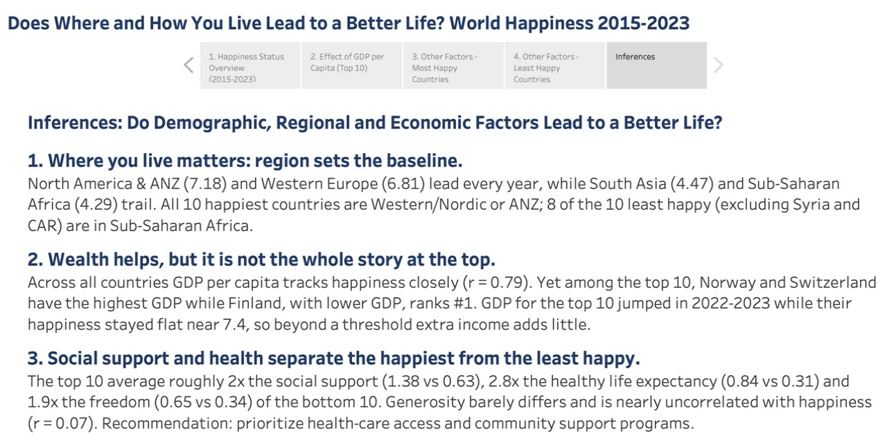
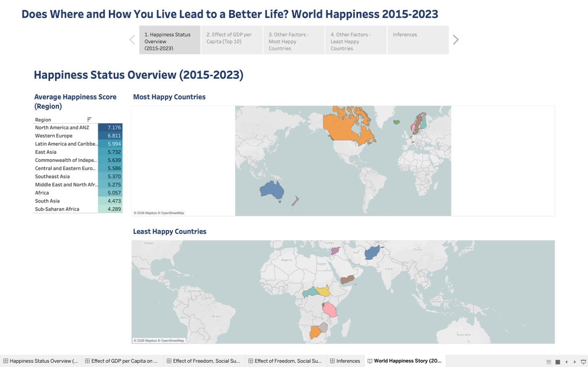
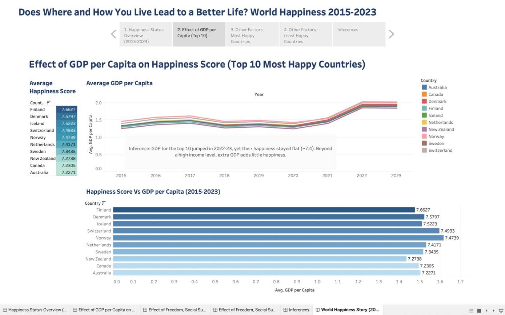
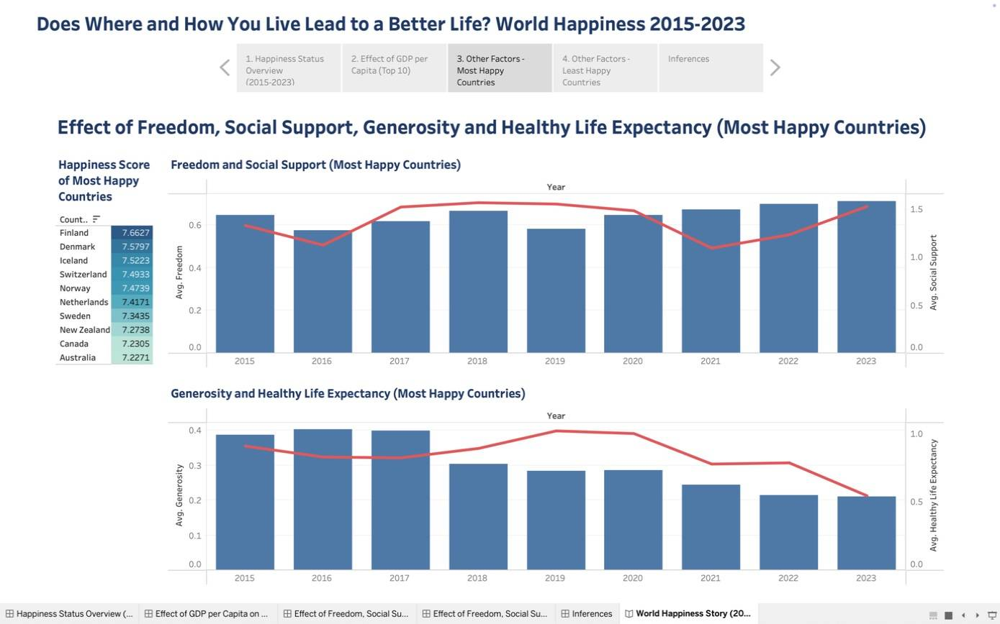
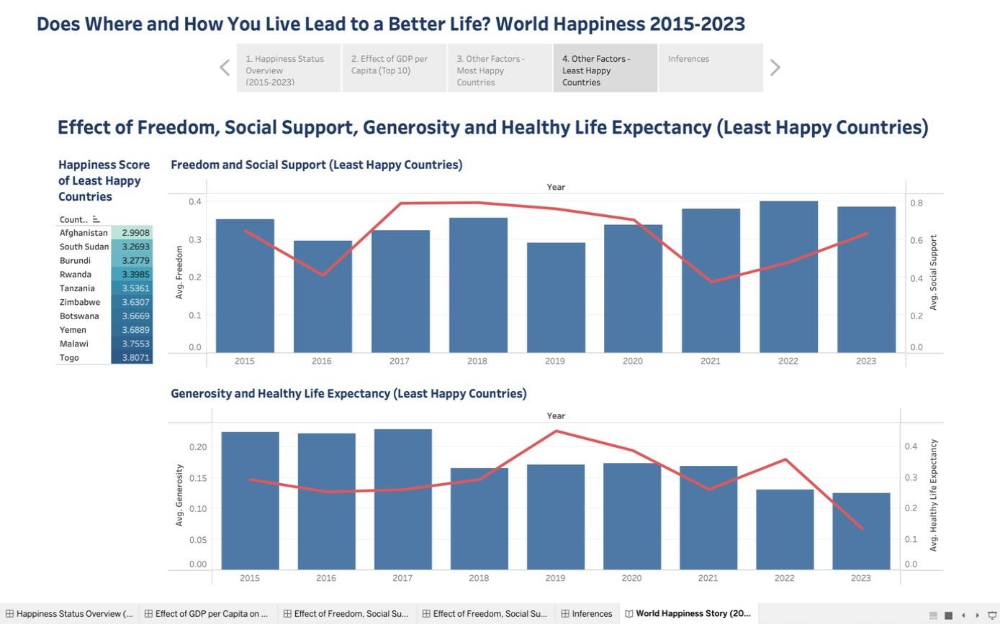

# World Happiness 2015–2023: does where and how you live lead to a better life?

**Live story (Tableau Public):** https://public.tableau.com/app/profile/roy.perez6706/viz/MyFinalProjectRoy/WorldHappinessStory2015-2023

A five-part Tableau story built on World Happiness Report scores for 2015–2023. It asks what separates the happiest countries from the least happy: region, income, or the social factors the report measures (social support, healthy life expectancy, freedom, generosity).

## Findings

1. **Region sets the baseline.** North America & ANZ (7.18) and Western Europe (6.81) lead every year. South Asia (4.47) and Sub-Saharan Africa (4.29) trail. All 10 of the happiest countries are Western/Nordic or ANZ, and 8 of the 10 least happy are in Sub-Saharan Africa. (Syria and the Central African Republic are left out of the bottom 10 because they appear in only 5 of the 9 years.)
2. **Wealth helps, but it is not the whole story at the top.** Across country averages, GDP per capita tracks happiness closely (r = 0.79). Within the top 10, though, Norway and Switzerland have the highest GDP while Finland ranks #1 with less. Top-10 GDP jumped in 2022–23 while their happiness stayed flat near 7.4, so past a certain income level, more money adds little.
3. **Social support and health separate the happiest from the least happy.** Compared with the bottom 10, the top 10 average about 2x the social support (1.38 vs 0.63), 2.8x the healthy life expectancy (0.84 vs 0.31) and 1.9x the freedom (0.65 vs 0.34). Generosity barely differs between the two groups and is nearly uncorrelated with happiness (r = 0.07).

**Recommendation:** for a country trying to raise well-being, put health-care access and community support ahead of income growth alone.

**Caveats.** These are correlations, not causes. The scores are the report's survey-based measures, and the number of countries varies by year (137 to 158).

## The story

| # | Story point | What it shows |
|---|---|---|
| 1 | Happiness Status Overview | Average score by region (highlight table), plus maps of the 10 happiest and 10 least happy countries |
| 2 | Effect of GDP per Capita | GDP per capita over time for the top 10, and happiness vs. GDP by country |
| 3 | Other Factors: Most Happy | Freedom and social support, generosity and healthy life expectancy, 2015–2023 (dual-axis bar + line) |
| 4 | Other Factors: Least Happy | The same four factors for the bottom 10 |
| 5 | Inferences | The three findings above |

| | |
|---|---|
|  |  |
|  |  |

## Data

| File | Contents | Grain |
|---|---|---|
| `data/WHR_15_23.csv` | World Happiness Report scores, 2015–2023 | one row per country per year (1,367 rows, 171 countries) |
| `workbook/WorldHappinessStory.twbx` | Packaged Tableau workbook (open with Tableau Public or Desktop) | |

Columns: `country`, `region`, `happiness_score`, `gdp_per_capita`, `generosity`, `social_support`, `freedom_to_make_life_choices`, `healthy_life_expectancy`, `year`.

## Tools
Tableau Public (filled maps, highlight tables, dual-axis charts, story points).

Built as the final project for *Getting Started with Tableau*, part of the IBM Data Management certificate on Coursera.

## About
Roy James Perez · MIS & Data Analytics, Texas A&M International University · [LinkedIn](https://www.linkedin.com/in/royjamesperezflores) · [GitHub](https://github.com/royjamesperezflores)
